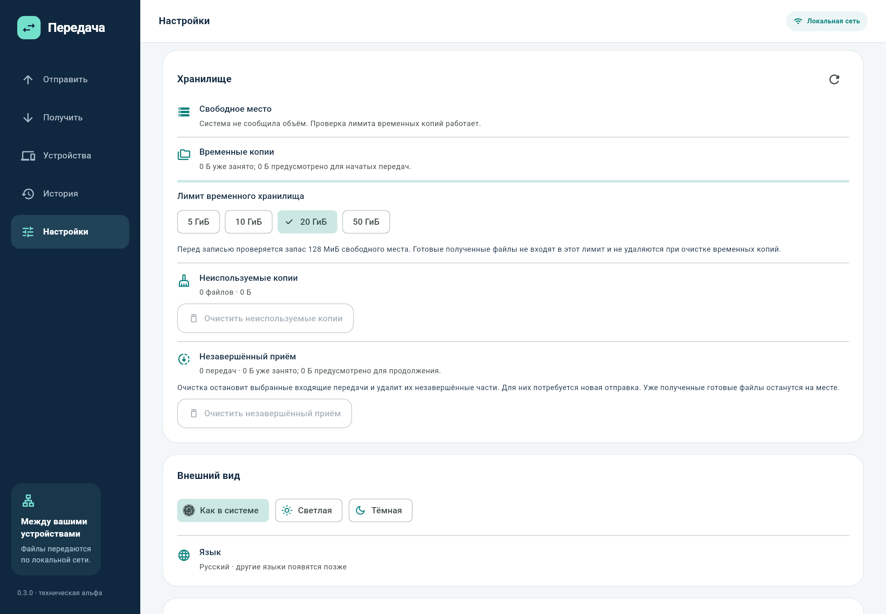

# Передача файлов · 0.3.0

Русский интерфейс и реальная локальная передача файлов на Flutter/Dart.

**Статус: техническая альфа, третья итерация реализации ТЗ.** В проекте работают foreground HTTPS push, ручное сопряжение, согласие на получение, потоковая запись, SHA-256 и докачка. Это ещё не выпуск 1.0: аппаратная матрица iOS ↔ Android ↔ Windows, фоновые интеграции и часть P0 остаются открытыми.



Новый блок версии 0.3: ограниченные автоматические повторы при обрыве связи, срок входящего предложения 120 секунд, новая отправка сохранённых копий по явному действию пользователя и безопасная очистка незавершённого приёма. Полное описание — `docs/RELEASE_NOTES_v0_3_0_RU.md`. Системный экспорт и общий бюджет хранилища из 0.2 сохранены.

## Состав

| Каталог | Назначение |
|---|---|
| `apps/file_transfer` | Flutter-приложение и платформенные проекты iOS, Android, Windows; Linux используется для разработки |
| `packages/transfer_core` | Независимое Dart-ядро HTTPS, идентичности, сопряжения, дискового хранилища и SQLite |
| `docs/SPECIFICATION_v1_0_RU.md` | Исходное согласованное техническое задание |
| `docs/IMPLEMENTATION_STATUS_RU.md` | Реализованное, ограничения и следующие задачи |
| `docs/TEST_REPORT_RU.md` | Фактические проверки и границы доказанного |
| `docs/verification` | Машиночитаемые результаты проверок без пользовательских секретов |
| `docs/previews` | Рендер настоящих Flutter widgets для desktop/mobile размеров |
| `scripts/verify.py` | Запуск статического анализа и автоматических тестов |
| `scripts/build_android.py` | Переносимая подготовка вызова Android-сборки |

## Что уже реализовано

- Пять экранов: «Отправить», «Получить», «Устройства», «История», «Настройки». Светлая/тёмная темы, адаптивная навигация, крупный системный шрифт.
- Системный выбор файлов и desktop drag-and-drop. Android `content://` читается потоком через API провайдера; URI не превращается в вымышленный путь.
- Неизменяемая подготовленная копия источника в управляемом outbox. Сетевой перенос не зависит от последующего удаления обычного оригинала.
- Bonjour/NSD через нативный плагин как подсказка адреса, QR-приглашение и ручная вставка приглашения. На iOS/Android подключён экран камеры.
- Проверяемое сопряжение: QR с SPKI и одноразовым секретом, подтверждение на принимающем устройстве, отдельные credentials для двух направлений.
- TLS-проверка SHA-256 DER SubjectPublicKeyInfo до отправки HTTP credentials. Перенаправления и plaintext fallback запрещены.
- Keychain/Android secure storage/Windows user-scoped DPAPI через платформенный адаптер. Ошибка доступа не сбрасывает идентичность и не включает plaintext-хранилище.
- Согласие на каждую входящую передачу. Автоматический приём не включён.
- Потоковая загрузка с HEAD/PATCH, устойчивое смещение, докачка, проверка SHA-256 реального файла на получателе и подтверждение окончательного сохранения.
- Пауза с независимыми флагами отправителя и получателя, отмена, локальная история, сохранение намерения отмены при перезапуске.
- До пяти автоматических повторов сетевой операции: базовые задержки 1/2/4/8/16 секунд плюс 0–25% случайного разброса. Пауза, отмена, отзыв доверия, сворачивание и закрытие останавливают ожидание.
- Входящее предложение без согласия истекает через 120 секунд; старый requestId не создаёт его повторно. Для новой попытки можно явно отправить сохранённые подготовленные копии без повторного выбора оригиналов, если в прежнем пакете нет подтверждённых файлов.
- Просмотр любого успешно полученного файла из пакета через явное действие пользователя.
- Системное «Сохранить копию…» для каждого подтверждённого файла: Android SAF, iOS document export, Windows Save dialog. Статус копирования хранится отдельно от сетевой доставки; отмена и неопределённый результат не становятся успехом.
- Общий бюджет исходящих и незавершённых входящих данных: квота по умолчанию 20 ГиБ, настройки 5/10/20/50 ГиБ, запас 128 МиБ при доступном системном измерении. Счётчики и обязательства восстанавливаются после перезапуска.
- Очистка явно подтверждённых неиспользуемых исходящих копий. Отдельное действие останавливает перечисленные незавершённые входящие передачи, удаляет только их временные части и освобождает резерв. Готовые результаты, подтверждения и неразрешённое намерение окончательного сохранения защищены.
- Корректная остановка foreground-сессии при сворачивании мобильного приложения. Отключённый пользователем приём не включается сам при возвращении.

## Запуск из исходников

Зафиксированная среда этой итерации: **Flutter 3.50.1 / Dart 3.14.0**. Версии разрешённых зависимостей сохранены в обоих `pubspec.lock`.

Установите Flutter и нативную среду нужной платформы. Сборка iOS выполняется на macOS с Xcode, Windows — на Windows с Desktop development with C++. Android требует полноценный JDK, Android SDK/NDK и принятые лицензии SDK. Инструкции установки Flutter: https://docs.flutter.dev/install.

Из корня проекта:

```bash
cd packages/transfer_core
dart pub get
cd ../../apps/file_transfer
flutter pub get
flutter run
```

Для конкретного устройства используйте идентификатор из `flutter devices`:

```bash
flutter run -d DEVICE_ID
```

В этой рабочей среде служебная проверка версии Flutter зависала на сетевом запросе. Для воспроизводимой автоматической проверки скрипт задаёт штатный CI-режим, отключает телеметрию и использует `--no-version-check`. Это не меняет проверку TLS приложения.

## Первая передача между двумя установками

1. Подключите устройства к одной Wi-Fi/LAN сети. На время проверки оставьте приложения открытыми. Гостевая сеть с изоляцией клиентов не подходит.
2. На принимающем устройстве откройте **«Получить» → «Показать приглашение»**.
3. На отправителе откройте **«Устройства»**, отсканируйте QR либо вставьте скопированное приглашение.
4. На принимающем устройстве подтвердите запрос сопряжения. QR первоначально действует 120 секунд; ожидание подтверждения ограничено отдельно.
5. Выберите файлы на отправителе. Дождитесь подготовки: приложение создаёт отдельную неизменяемую копию и вычисляет контрольную сумму.
6. Выберите подключённое устройство и нажмите отправку. Подтвердите входящий пакет на получателе в течение 120 секунд. После истечения срока отправитель может нажать «Отправить снова»: создаётся новый запрос и снова требуется согласие.
7. Дождитесь результата **«Завершено»**. Достижение 100% байтов во время проверки ещё не считается доставкой.
8. Чтобы сохранить файл вне приложения, откройте его передачу в истории, нажмите **«Сохранить копию…»**, при необходимости выберите файл из пакета и укажите место в системном диалоге. Отмена окна оставляет исходный полученный файл в приложении.
9. При кратком обрыве сети приложение выполнит до пяти повторов самостоятельно, сохраняя идентификаторы передачи и подтверждённое смещение. После исчерпания попыток, сворачивания или перезапуска откройте оба приложения и нажмите **«Продолжить»** в истории отправителя. Если получатель вручную поставил паузу, он сначала снимает свою паузу.

Для повторного обмена QR не требуется, пока идентичности устройств сохранены и новый адрес найден. Изменение IP само по себе не заменяет закреплённый ключ. При отказе автообнаружения QR помогает только при наличии сетевого маршрута.

## Где лежат файлы

Данные находятся в `Application Support/file-transfer-v1/` соответствующей ОС:

- `outbox/` — подготовленные копии источников;
- `inbox/.staging/` — незавершённые входящие файлы;
- `inbox/received/<transferId>/<storageIncarnationId>/` — проверенные результаты;
- отдельные SQLite-журналы входящих и исходящих операций.

Ключи, токены и pending pairing хранятся через OS SecretStore, а не в этих журналах. Отладочные ключи и credentials в архив не входят. Исходные выбранные пользователем файлы приложение не удаляет и не перемещает.

Системное сохранение копии и настройки временной квоты добавлены в 0.2. В 0.3 появилась отдельная ручная очистка незавершённого приёма: «Настройки → Хранилище → Очистить незавершённый приём». Подтверждаются конкретные передачи, их приём останавливается, докачка становится невозможной, готовые файлы и история остаются. Произвольные orphan-файлы вне строк журнала не удаляются.

Подготовленные исходящие копии неуспешных попыток сохраняются, даже если получатель отказал или срок предложения истёк. Их можно явно отправить снова при отсутствии подтверждённых файлов в старом пакете либо удалить отдельной подтверждённой очисткой. Если пользователь ранее удалил оригинал, копия может оказаться единственной: диалог прямо объясняет последствие её удаления. Автоматическое удаление по срокам 7/30 дней, лимит истории и отдельный экспорт в Photos пока не реализованы. Файлы не открываются и не распаковываются автоматически.

Измерение свободного места относится к файловой системе внутреннего хранилища приложения. Когда ОС не возвращает число, интерфейс показывает отсутствие измерения, а временная квота продолжает действовать. Резервирование в бюджете приложения не резервирует блоки диска у ОС; ошибки реальной записи всё равно обрабатываются. Возможность сохранения в выбранный внешний или облачный провайдер проверяется отдельно результатом системного экспорта.

## Проверка

```bash
python3 scripts/verify.py --flutter /absolute/path/to/flutter/bin/flutter
```

В PowerShell укажите путь к `flutter.bat` вместо Unix-пути.

Для отдельного испытания настоящего HTTPS и докачки:

```bash
cd packages/transfer_core
dart run bin/loopback_probe.dart --mib 1024 --output /absolute/path/to/new/probe-directory
```

CLI создаёт файл **1 073 741 824 байта**, выполняет сопряжение с ручным подтверждением, проверяет запрет передачи без согласия, обрывает перенос после подтверждённого префикса, перезапускает оба хранилища, восстанавливает бюджет, докачивает и проверяет SHA-256. Подготовленная копия удаляется только после полного committed receipt; итоговые временные данные и будущие резервы должны быть нулевыми. Выходной каталог должен быть новым. Программа сохраняет источник, результат и `result.json` для независимой проверки; на пике потребуется больше 3 ГиБ свободного места. CLI честно не заявляет нативного измерения свободного места: `availableBytes=null`, а квота и учёт резервов работают.

Это два логических узла в одной среде. Такой тест не подменяет испытание телефонов, Windows, камеры, системных разрешений, Wi-Fi или фонового исполнения.

## Сборка

Android:

```bash
python3 scripts/build_android.py --help
```

См. `docs/ANDROID_BUILD.md` и фактический отчёт `docs/TEST_REPORT_RU.md`. Android-пакет этой итерации называется **«Передача файлов α0.3»**, debug applicationId — `uz.sardor.file_transfer.alpha02`, версия `0.3.0`, ARM64, min API 29, target API 37.

Сертификат и applicationId совпадают с выданной 0.2, поэтому 0.3 подготовлена как обновление этой установки с сохранением данных. Установка обновления на физический телефон ещё не проверена. Для 0.1 остаётся отдельная линия установки: её сертификат отличался, миграция из 0.1 не реализована. Не удаляйте старое приложение ради установки нового. APK предназначен для внутренней проверки, без production signing. Release-конфигурация не подписывается debug-ключом автоматически.

Windows:

```powershell
cd apps/file_transfer
flutter pub get
flutter build windows --release
```

iOS, на Mac:

```bash
cd apps/file_transfer
flutter pub get
flutter build ios --debug --no-codesign
```

Для запуска на iPhone откройте iOS-проект в Xcode, выберите свою Signing Team и подпишите приложение. Bundle IDs пока служебные: `uz.sardor.file_transfer` для Android release (`.alpha02` добавляется только к debug) и `uz.sardor.fileTransfer` для iOS. Перед публикацией утвердите постоянное имя и идентификаторы.

## Границы текущей версии

- Поддерживаемый здесь транспорт — **foreground push по IPv4**. Pull, IPv6-only, WebRTC/TURN, браузерный гость и Wi-Fi Aware ещё не реализованы.
- ОС-проекты и адаптеры трёх платформ находятся в исходниках; их наличие не доказывает аппаратную совместимость.
- Не готовы iOS Share Extension, Android foreground service, Windows tray/автозапуск и native background URLSession.
- Не реализованы выборочное принятие файлов, перенос папок, автоматическая очистка по сроку 7/30 дней, лимит истории, удаление неучтённых orphan-файлов и согласованный reset-receive. Ручная очистка входящих частей реализована в 0.3.
- Состояние `expired` добавлено в wire-модель. Для корректного отображения истечения предложения обновите обе стороны до 0.3; 0.2 останавливается на неизвестном состоянии без объявления успешной доставки. Полная матрица разных версий не выполнена.
- Срок предложения внутри процесса измеряется монотонно. После перезапуска используется сохранённый UTC deadline с ограничением остатка и отказом при обнаруженном откате часов; это не защита от всех изменений системного времени между запусками.
- Интерфейс этой итерации русский; переводы UZ/EN остаются задачей следующего этапа.
- Ограничения протокола 10 ГиБ/файл, 1 000 файлов и 50 ГиБ/пакет являются валидируемыми проектными пределами. Они **не означают**, что максимумы уже испытаны на телефонах.
- Нет обязательного аккаунта, облачного API, удалённой телеметрии приложения и встроенной рекламы.

Нативные compile jobs для iOS и Windows добавлены в `.github/workflows/verify.yml`, но не выполнялись в этой Linux-среде. Инструкции: `docs/NATIVE_BUILD_GATES.md`.

Полная таблица соответствия и очередь задач: `docs/IMPLEMENTATION_STATUS_RU.md`.

## История исходников в архиве

Передаваемый архив содержит `SOURCE_COMMIT.txt` с точной ревизией и `HISTORY.bundle` с локальной Git-историей восстановленной 0.1 и этой итерации. Их можно использовать для продолжения разработки после переноса на другую машину. Bundle не содержит SDK, сборочных кэшей или signing keys. Пример восстановления истории в отдельный каталог: `git clone HISTORY.bundle file-transfer-history`.
